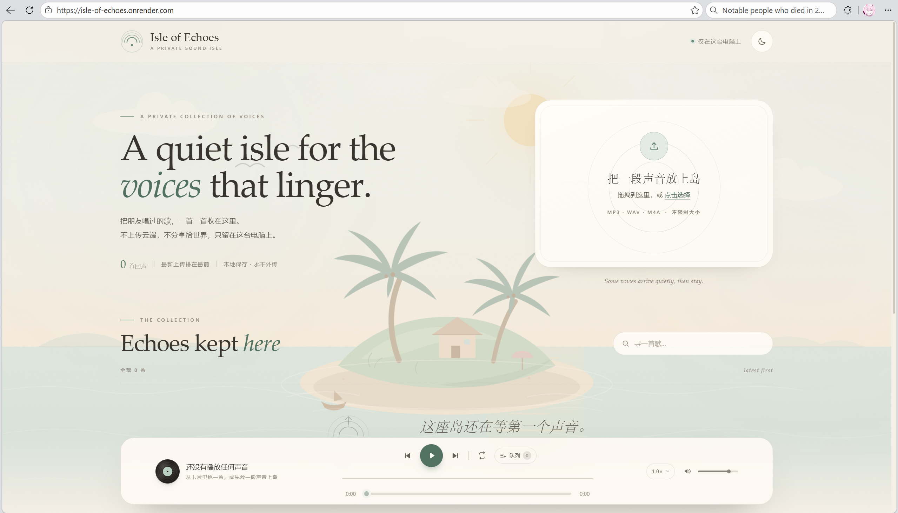
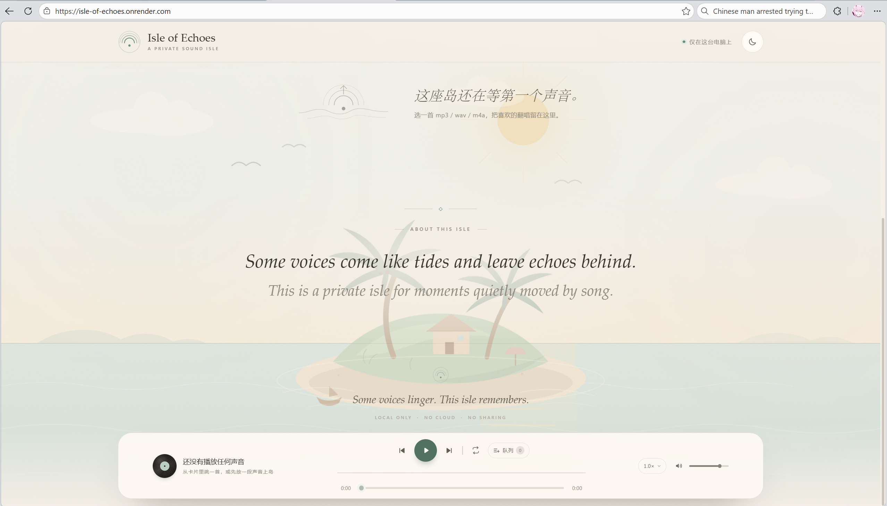

# Isle of Echoes · 回声之岛

一座只在你自己的电脑上存在的声音小岛。把唱过的歌收在这里：上传、重命名、播放、排队、循环，也可以随时删除。没有账号，没有云端，没有分享，也没有人会路过。

- **技术栈**：Node.js + Express 5，原生 HTML / CSS / JavaScript，无构建步骤
- **访问方式**：只监听 `127.0.0.1`，外部网络无法访问
- **数据存放**：音频在 `audio/`，元数据在 `data/tracks.json`，重启不丢
- **视觉**：温柔文艺的米白 / 墨绿配色，支持浅色与深色一键切换；浅色背景是晴日海面上的假日小岛，深色背景切换为同一座岛的落日傍晚；意大利斜体、慢速唱片旋转

## 界面预览

首页上半部分：上传卡片与歌曲收藏。



页面下半部分：空岛提示、关于这座岛与常驻播放器。



---

## 1. 运行环境

| 依赖 | 版本要求 |
| --- | --- |
| Node.js | 18 或更高（推荐 20 / 22 LTS） |
| npm | 随 Node.js 一起安装即可 |
| 浏览器 | 最新版 Edge / Chrome / Safari（Firefox 对部分 m4a 编码支持有限） |

如果电脑还没有 Node.js：

1. 打开 <https://nodejs.org/>，下载 **LTS** 版本；
2. 安装时保持默认选项（会自动加入 PATH）；
3. 安装完成后重新打开终端，运行 `node -v`，能看到版本号即可。

> 项目已附带安装好的 `node_modules`。如果它还在，可以跳过第 2 步直接启动。

---

## 2. 安装与启动

### 第一次使用

在项目文件夹中打开终端（PowerShell 或 CMD），执行：

```bash
npm install
npm start
```

看到下面的提示就成功了：

```
  Isle of Echoes  ·  回声之岛
  本地地址：http://127.0.0.1:3000
  音频目录：D:\...\isle-of-echoes\audio
  仅监听本机，关闭此窗口即可停止服务。
```

然后用浏览器打开：

**<http://127.0.0.1:3000>**

也可以在 Windows 上直接双击项目里的 **`start.bat`**：它会自动进入项目目录并启动服务；如果系统里没有 Node.js，还会尝试使用 DeepSeek Harness 自带的 Node 运行时。如果检测到服务已经在 3000 端口运行，它会直接打开浏览器，不会重复启动第二个副本。

### 停止服务

在启动服务的窗口里按 `Ctrl + C`，或直接关闭那个窗口。

### 换一个端口

3000 被其他程序占用时，可以临时换端口：

```powershell
# PowerShell
$env:PORT=3100; npm start

# CMD
set PORT=3100 && npm start
```

随后访问 <http://127.0.0.1:3100>。

### 开发模式（可选）

```bash
npm run dev
```

使用 Node 的 `--watch`，修改后端代码后自动重启。前端是原生文件，刷新浏览器即可看到改动。

---

## 3. 项目文件夹说明

```text
isle-of-echoes/
├─ server.js                 # Express 入口：路由、上传校验、启动服务
├─ lib/
│  ├─ filename.js            # 文件名清洗、中文解码、格式判断
│  ├─ trackStore.js          # tracks.json 的读写与原子持久化
│  └─ mediaStream.js         # 支持 Range 的音频流（拖动进度条靠它）
├─ public/                   # 所有前端静态文件
│  ├─ index.html             # 页面结构、图标库
│  ├─ favicon.svg            # 小岛与回声意象的 favicon
│  └─ assets/
│     ├─ css/style.css       # 主题、卡片、唱片、播放器样式
│     └─ js/
│        ├─ app.js           # 页面渲染、搜索、分页、上传、提示
│        ├─ player.js        # 全局播放器、队列、循环、倍速、音量
│        ├─ api.js           # 与后端通信
│        └─ utils.js         # 时间 / 大小 / 颜色等小工具
├─ audio/                    # 音频实体文件（上传后自动出现在这里）
│  └─ .gitkeep
├─ data/
│  └─ tracks.json            # 歌曲元数据（首次启动自动生成）
├─ start.bat                 # Windows 一键启动
├─ package.json
├─ pnpm-lock.yaml            # 依赖锁文件（使用 pnpm 安装时生成）
├─ .gitignore
└─ README.md
```

**不要删除 `audio/` 和 `data/` 文件夹**；它们就是这座岛的全部记忆。

---

## 4. 使用说明

### 上传一首歌

- 点击右上方的上传卡片，选择文件；或直接把文件拖进上传卡片。
- 支持格式：**MP3 / WAV / M4A**，单文件大小不限制。
- 可以一次选多个文件，会按顺序逐个上传；上传卡片里有真实进度条，批量时显示「第 x / n 个 + 单文件百分比」。
- 上传完成后自动用**文件名（去掉扩展名）作为歌名**，并记录上传时间；最新上传的排在最前面。
- 如果 `audio/` 里已有同名文件，会阻止上传并在页面顶部提示，不会覆盖原文件。
- 上传失败、格式不支持等情况都会以顶部文字提示条的形式出现，不会弹窗。

### 找到一首歌

- 顶部搜索框会按歌名 / 文件名实时筛选卡片；
- 每页固定 **16 首**，底部分页可翻页；
- 清空搜索框或点击右侧的 × 即可回到全部收藏。

### 播放

- **单击卡片**：播放这首，并用当前筛选结果重置播放队列；
- 卡片上的 **播放** 按钮：播放 / 暂停这首；
- 卡片上的 **加入队列**：只把这首追加到队列末尾，不打断当前播放；
- 页面底部是常驻播放器：上一首、播放 / 暂停、下一首、进度拖拽、音量、倍速、循环模式、队列列表；
- 播放新歌时会自动暂停上一首（全站只有一个 `<audio>`，天然互斥）；
- 播放中的卡片会显示绿色描边、跳动的小均衡器和缓慢旋转的黑胶唱片；
- **全屏「正在播放」页**：点击播放器左下角的黑胶唱片展开，中部大唱片随播放旋转、暂停时停在原角度；进度条、时间、播放状态与底部播放器实时双向同步，空格键即可播放 / 暂停，Esc、点遮罩或收起按钮都能关闭。

### 重命名 / 删除

- 每张卡片右上角的 **⋯** 按钮里有两项操作：**重命名**和**删除**。
- **重命名**只改变网页上显示的歌名，不会改动 `audio/` 里的音频文件；歌名为 1–120 个字符，保存后会同步更新卡片、播放器和播放队列。
- **删除**会先弹出确认框；确认后会同时移除 `audio/` 里的音频文件和 `data/tracks.json` 里的记录，**无法恢复**。
- 如果删除的是正在播放的曲目，会尝试顺延到队列中的下一首；没有下一首时播放器回到空闲状态。
- 删除正在被其他程序占用的文件时，会提示“音频文件正在被使用”，暂停播放后再试即可。

### 循环模式

点击播放器上的循环按钮，会在四种模式之间切换：

1. **顺序播放**：按队列顺序播放，放完最后一首就停下；
2. **单曲循环**：当前这首反复播放；
3. **列表循环**：放完最后一首后回到第一首继续；
4. **随机播放**：本轮没播过的曲目里随机挑一首，全部播完自动重新洗牌。

图标和按钮提示会同步变化，选择会保存在浏览器里。

### 倍速与音量

- 倍速：`0.5× / 0.75× / 1.0× / 1.25× / 1.5× / 1.75× / 2.0×`；
- 音量滑块与静音按钮会记住上次的音量；
- 进度条可以点击或拖拽跳转，音频服务支持 HTTP Range，所以拖拽后能立即续播。

### 浅色 / 深色

点击右上角的太阳 / 月亮按钮切换主题。默认会跟随系统的深浅色偏好，手动切换后会记住你的选择。

### 键盘小快捷键

- `空格`：播放 / 暂停（输入框或按钮获得焦点时不会触发）；
- `/`：快速聚焦搜索框；
- `Esc`：关闭队列 / 倍速菜单 / 全屏播放页，或在搜索框中清空内容。

全屏「正在播放」页打开后，`空格` 与 `/` 等快捷键依然可用。

---

## 5. 数据、备份与删除

### 数据在哪里

- 音频实体：`audio/<原始文件名>`
- 元数据：`data/tracks.json`

`tracks.json` 的结构如下：

```json
{
  "version": 1,
  "tracks": [
    {
      "id": "0f0b6f0e-8f0e-4f0e-9d1a-3a7a1f6d2c11",
      "filename": "寫給島嶼的一封信.mp3",
      "title": "寫給島嶼的一封信",
      "uploadedAt": "2026-11-11T07:46:16.923Z",
      "size": 5823110
    }
  ]
}
```

- `id`：内部唯一标识，用于生成播放地址；
- `filename`：`audio/` 里的实际文件名；
- `title`：卡片上显示的歌名（默认取文件名去掉扩展名，可在网页上用「重命名」修改）；
- `uploadedAt`：ISO 时间，页面按浏览器本地时区显示；
- `size`：字节数。

### 备份

把整个 `audio/` 文件夹和 `data/tracks.json` 复制到别处即可；两者要一起备份。

### 手动删除一首歌（网页上也可以直接删）

正常情况下，直接用卡片菜单里的 **删除** 即可，服务会同时处理音频文件和元数据。只有在服务无法启动、需要手动清理时，才按下面的步骤操作：

1. 在启动窗口按 `Ctrl + C` 停止服务；
2. 打开 `audio/`，删除对应的音频文件；
3. 用文本编辑器打开 `data/tracks.json`，删除 `tracks` 数组里 `filename` 对应的那个对象；
4. 确认 JSON 格式仍然正确（逗号、括号不要多也不要少）；
5. 重新运行 `npm start`。

> 只删音频、不删元数据，会留下一张点开就报错的卡片；只删元数据、不删音频，则文件会占着空间但不出现在页面上。建议两边一起处理。
> 如果手动在资源管理器里改了音频文件名，也要同步修改 JSON 里的 `filename`，否则网页会找不到文件。
> 网页上的「加入队列」只是播放队列，不会删除任何文件。

### 清空整座岛

停止服务后，删除 `audio/` 里除 `.gitkeep` 外的所有音频文件，再删除 `data/tracks.json`，然后重新启动。服务会生成一份空的元数据文件。

---

## 6. 隐私与安全

- 服务默认只绑定 **`127.0.0.1`**（IPv4 回环地址），同一局域网内的其他电脑、手机都无法访问；
- 没有登录、没有账号、没有评论、没有分享、没有第三方云存储，所有文件只在本机；
- 本机使用请不要把 `HOST` 改成 `0.0.0.0`，也不要做端口转发 / 内网穿透 —— 那会让这座私人小岛暴露在公网；如果确实想公开部署，请先阅读第 8 节「部署到云端」，了解隐私与版权后果；
- 网页提供本地删除接口（卡片 **⋯ → 删除**），只在本机可用；删除会物理移除 `audio/` 里的音频文件，请先确认并做好备份；
- 本机其他用户如果能打开你的浏览器或文件夹，仍然可以看到这些文件，这是本地应用的正常边界。

---

## 7. 常见问题

**启动时提示端口被占用**

换一个端口：

```powershell
$env:PORT=3100; npm start
```

**双击 `start.bat` 提示找不到 Node.js**

安装 Node.js LTS，或重新打开一个终端让 PATH 生效。`start.bat` 也会尝试使用 DeepSeek Harness 自带的 Node 运行时。

**页面能打开，但上传后列表没有刷新**

先确认启动窗口没有报错；再刷新页面。如果 `data/tracks.json` 被手动改坏，服务启动时会报 JSON 解析错误，按上一节的格式修复即可。

**上传时提示「已经在岛上了」**

`audio/` 里存在同名文件（不区分大小写）。想重新上传，请先用卡片菜单删除旧曲目（或按手动步骤处理），或把新文件改名。

**上传 m4a 后浏览器无法播放**

m4a 通常封装 AAC；Edge / Chrome / Safari 支持较好，部分 Firefox 版本缺少 AAC 解码能力。可以先用其他播放器确认文件本身正常，或转成 mp3 再上传。

**音频拖进度条没有反应**

本项目已经实现 Range 请求；如果仍无法拖动，确认音频文件完整、未被其他程序占用，并尝试刷新页面。

**直接把音频文件复制进 `audio/` 会出现在网页上吗？**

不会。页面只读取 `data/tracks.json` 里的记录。若要手动添加，必须在 JSON 里补一条对应记录（`filename` 要跟实际文件名完全一致），再重启服务。

**想换歌名**

打开卡片右上角的 **⋯ → 重命名**，改完保存即可。它只改变网页显示的歌名，不会重命名 `audio/` 里的文件。如果也想改实际文件名，请停止服务后在资源管理器里改名，并同步修改 `tracks.json` 的 `filename`，或者重新上传。

**删除后还能恢复吗？**

不能。网页删除是直接移除音频文件的，没有回收站。重要音频请在删除前备份 `audio/` 和 `data/tracks.json`。

**能在外网访问吗？**

不能，也不建议。服务只监听本机回环地址；把地址发给别人是打不开的。

---

## 8. 部署到云端（可选）

想让其他人通过网址访问时，可以把仓库部署到支持 Node 的免费云平台（如 Render、Railway、Fly.io）。GitHub 本身只托管代码，不能运行这个网站的后端。

部署前请确认你接受以下几点：

- **仓库是公开的**：`audio/` 与 `data/tracks.json` 已被 `.gitignore` 排除，代码里不含任何音频；但任何人都能读到源码与接口设计；
- **公网访问没有隐私**：上传 / 删除接口对所有访客开放（服务端有来源校验，只拦跨站请求，不拦直接访问），任何人都能删掉岛上全部音频；
- **免费平台的磁盘是临时的**：重新部署或休眠重启后，访客上传的音频和 `tracks.json` 会清空，本机那三首歌不会跟上去；
- **版权**：不要把翻唱音频提交进公开仓库。

部署要点（以 Render 为例）：

1. 在 GitHub 创建公开仓库并推送代码；
2. 在 Render 新建 Web Service，连接该仓库；
3. Build command：`npm install`，Start command：`npm start`；
4. 平台会注入 `PORT` 与 `RENDER=true`（注意：**不会**注入 `HOST`）；服务代码检测到 `RENDER=true` 时会自动改绑 `0.0.0.0` 以接收外部请求，无需额外配置；
5. 如需持久保存上传的文件，请为服务挂载持久磁盘（付费），并让 `audio/`、`data/` 指向它。

---

## 9. 一点技术说明（可选阅读）

- `POST /api/upload`：使用 Multer 接收文件，校验扩展名、空文件与同名文件，写入 `audio/` 后再追加元数据；
- 元数据通过「临时文件 + 原子重命名」持久化，避免写入中断损坏 JSON；
- `GET /api/tracks`：按 `uploadedAt` 倒序返回列表；
- `PATCH /api/tracks/:id`：局部更新，支持修改显示歌名（`title`）与回填时长（`duration`，秒，前端探测后自动写入）；
- `DELETE /api/tracks/:id`：删除音频文件与元数据记录；
- `GET /media/:id`：按 ID 流式发送音频，支持 `Range` / `206 Partial Content` / `HEAD`；
- 前端为原生 ES Modules，无打包步骤；
- 主题、音量、倍速、循环模式保存在浏览器 `localStorage`；歌曲数据不在浏览器，只在本机文件里。

---

愿这座岛替你们记住那些轻轻唱过的晚上。
